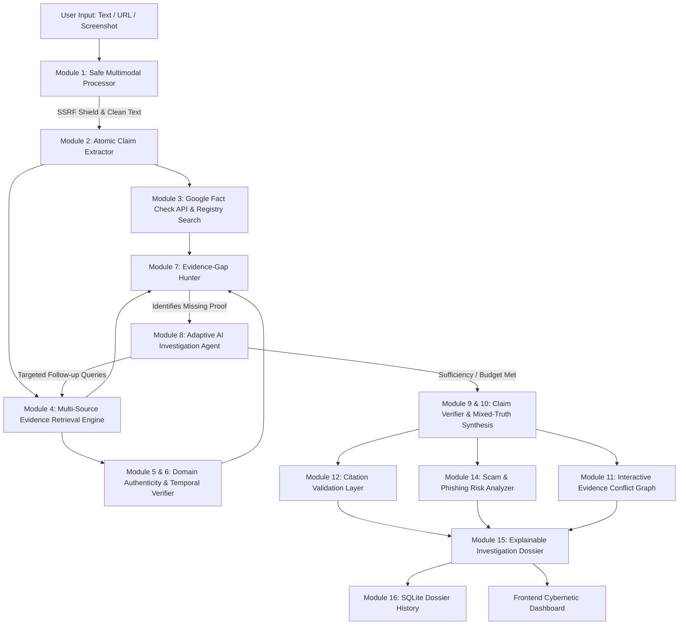

# 🛡️ VERITAS AI

### Autonomous AI-Powered Misinformation Detection, Evidence Investigation and Claim Verification Platform

> **Core Research Innovation:** *Evidence-Gap-Driven Adaptive Investigation with Claim-Level Evidence Traceability.*  
> VERITAS AI does not simply classify news as "Real" or "Fake" — it decomposes messages into atomic verifiable propositions, identifies missing evidence, dispatches targeted adaptive searches, resolves conflicting sources, validates citations, and produces a fully explainable uncertainty-aware dossier.

---

## 🌟 Key Highlights & Differentiators

| Capability | Traditional Fact-Checkers | VERITAS AI |
| :--- | :--- | :--- |
| **Claim Processing** | Monolithic text classification | **Atomic claim decomposition** (CLM-001, CLM-002...) |
| **Evidence Evaluation** | Keyword matching / URL presence | **Multi-source evidence mapping** with official domain registry |
| **Evidence-Gap Hunting** | ❌ Not tracked | **Identifies missing proof, unverified amounts, and expired dates** |
| **Adaptive Investigation** | Single-pass one-shot lookup | **Multi-step budget-controlled adaptive loop** |
| **Citation Grounding** | Generative hallucination risk | **Lexical and semantic citation grounding audit** |
| **Mixed-Truth Handling** | Binary (True vs False) | **Fine-grained synthesis** (Supported + Contradicted + Unverified) |
| **Security Controls** | Often vulnerable to SSRF | **Strict SSRF protection shield (blocks RFC1918 & localhost)** |

---

## 🏛️ System Architecture



---

## 🚀 Quickstart Guide

### 1. Prerequisites
- Python 3.10+ (Tested on Python 3.14)
- Pip

### 2. Installation
```bash
git clone <repo-url>
cd "VERITAS AI"
pip install -r requirements.txt
```

### 3. Configuration (Optional)
The system runs completely out-of-the-box with deterministic heuristic engines, curated official registry search, and DuckDuckGo live retrieval.
To enable external LLM or Google Fact Check Tools API:
```bash
cp .env.example .env
```
Edit `.env` and add:
- `GEMINI_API_KEY=your_key_here` (Optional structured LLM extraction)
- `GOOGLE_FACTCHECK_API_KEY=your_key_here` (Optional Google Fact Check Tools API)

### 4. Running the Platform
Start the FastAPI server:
```bash
python -m uvicorn backend.main:app --host 127.0.0.1 --port 8000 --reload
```
Open your browser and navigate to:
👉 **[http://127.0.0.1:8000](http://127.0.0.1:8000)**

---

## 🧪 Running Automated Tests & Benchmark Lab

### Automated Pytest Suite
```bash
python -m pytest
```
*Executes all 16 unit and integration tests covering SSRF protection, claim extraction, evidence-gap hunting, citation validation, and FastAPI endpoints.*

### Live Benchmark Evaluation (Module 17 & 18)
You can trigger the comparative benchmark lab directly from the UI tab **"Research Lab"** or via API:
```bash
curl -X POST http://127.0.0.1:8000/api/evaluate
```
This runs controlled scenarios comparing:
1. **Superficial Baseline Classifier**
2. **Single-Pass Retrieval Pipeline**
3. **VERITAS AI Adaptive Pipeline**

---

## 🎯 Pre-Packaged Hackathon Demonstration Scenarios

| Scenario ID | Name | Core Misinformation Pattern |
| :--- | :--- | :--- |
| **DEMO-A** | Verified Institutional Portal | Legitimate National Scholarship Portal centralized announcement |
| **DEMO-B** | Outdated Expired Deadline | Genuine circular reposted with an expired past-year deadline (2021) |
| **DEMO-C** | Unverified Scholarship with Phishing Domain | Fabricated university scholarship offering ₹50,000 on lookalike `.xyz` domain |
| **DEMO-D** | Predatory Recruitment with Upfront Fee | Fake railway recruitment asking for ₹1,500 via GPay and Telegram redirect |
| **DEMO-E** | Mixed-Truth Scholarship Message | Genuine opportunity name combined with fabricated ₹1,00,000 grant and unverified Google Form |
| **DEMO-F** | Debunked Viral Scheme | Viral WhatsApp forward claiming free laptops under government scheme |
| **DEMO-G** | Uncorroborated New Local Internship | Novel internship opportunity with no prior fact check |

---

## 📂 Project Directory Structure

```
VERITAS AI/
├── backend/
│   ├── config.py             # Settings, official registry, risk patterns
│   ├── database.py           # SQLite persistence layer
│   ├── main.py               # FastAPI application with REST endpoints
│   ├── models/
│   │   └── schemas.py        # Pydantic v2 schemas for claims, evidence, reports
│   ├── modules/
│   │   ├── input_processor.py      # Module 1: Safe text, URL & SSRF shield
│   │   ├── claim_extractor.py      # Module 2: Atomic verifiable claim decomposition
│   │   ├── fact_check_search.py    # Module 3: Google Fact Check Tools API & curated debunks
│   │   ├── evidence_retriever.py   # Module 4: Multi-source search & official registry
│   │   ├── source_checker.py       # Module 5: Domain authenticity & impersonation detection
│   │   ├── temporal_verifier.py    # Module 6: Deadlines, academic cycles & expired dates
│   │   ├── evidence_gap_hunter.py  # Module 7: Core differentiator - hunts missing evidence
│   │   ├── adaptive_agent.py       # Module 8: Multi-step investigation loop
│   │   ├── claim_verifier.py       # Module 9 & 10: Claim-level verification & mixed-truth
│   │   ├── conflict_graph.py       # Module 11: Interactive evidence conflict graph data
│   │   ├── citation_validator.py   # Module 12: Citation grounding & anti-hallucination
│   │   ├── conflict_resolver.py    # Module 13: Authority hierarchy & syndication detection
│   │   ├── risk_analyzer.py        # Module 14: Scam signals, upfront fees, phishing
│   │   └── report_generator.py     # Module 15: Explainable investigation dossier
│   └── evaluation/
│       ├── benchmark_dataset.py    # Labeled test fixtures
│       └── evaluator.py            # Comparative baseline evaluation engine
├── frontend/
│   ├── index.html            # Dark navy & deep blue cybernetic dashboard
│   ├── css/style.css         # Modern typography and accessible layout
│   └── js/
│       ├── app.js            # Frontend controller & pipeline progress
│       └── graph.js          # HTML5 Canvas interactive conflict graph
├── tests/                    # Comprehensive Pytest test suite (16 tests)
├── .env.example              # Template configuration
├── requirements.txt          # Python dependencies
└── README.md                 # Complete platform documentation
```

---

## 📜 Ethical AI, Privacy & Limitations Disclosure

1. **Evidence-Based Assessments, Not Absolute Omniscience**: VERITAS AI provides assessments grounded strictly in available public digital records.
2. **Missing Proof ≠ Proof of Falsehood**: When an announcement cannot be verified, VERITAS AI labels it `UNVERIFIED` and identifies the specific evidence gap rather than arbitrarily condemning it as fake.
3. **SSRF & Privacy**: All URL requests are restricted to public IP ranges; private intranets (`127.0.0.1`, `10.0.0.0/8`, `192.168.0.0/16`, `172.16.0.0/12`) cannot be scanned through this tool. Uploaded screenshots are processed in memory and not retained unnecessarily.
